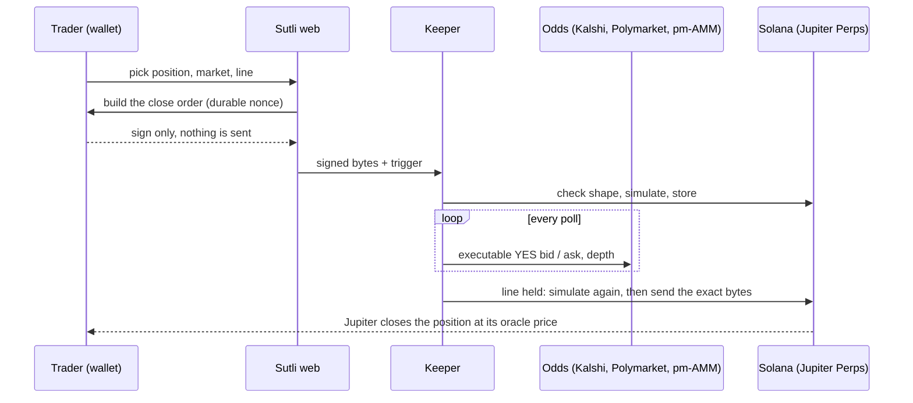

# Sutli

**Close your Jupiter perp when the news turns, not after the price does.**

Pick a prediction market and a line. Sign one close order in advance. When the odds cross your line, Sutli sends exactly that order and nothing else. It can never move your funds.

**Live app:** https://sutli-app.vercel.app · **Try it without a wallet:** https://sutli-app.vercel.app/#try

> On 10 October 2025, a 100% US tariff on China was announced, and more than **$19 billion** of leveraged crypto positions were force-closed within 24 hours, across about 1.6 million traders (CoinGlass data, via [Cointelegraph](https://cointelegraph.com/news/19b-crypto-market-crash-leverage-china-tariffs) and [Bloomberg](https://finance.yahoo.com/news/record-19bn-crypto-crash-exposes-194741410.html)). Stop losses and liquidations act on price, after the move. Sutli lets a trader tie the exit to the event itself, as priced by a prediction market.

Built for the Solana Foundation **Perps and Prediction Markets** hackathon (Nov–Dec 2026).

## Judges: start here

| Path | Time | Needs | What you see |
|---|---|---|---|
| **A. Try it** | 2 min | nothing | Open [the sandbox](https://sutli-app.vercel.app/#try). Click **Push the odds up**: a real trade on our pm-AMM market (Solana devnet) moves the odds past the line. Click **Run the dry run**: Sutli builds the exact close it would have you pre-sign for a real, open Jupiter position and runs it through mainnet's simulator. |
| **B. Read the order** | 5 min | nothing | [`src/core/order.ts`](src/core/order.ts) builds the order, [`src/core/guard.ts`](src/core/guard.ts) pins the position, [`keeper/server.ts`](keeper/server.ts) checks, simulates and sends. |
| **C. Arm a real position** | 10 min | Phantom or Solflare, an open Jupiter Perps position | **Arm a position** tab: pick the position, a Kalshi, Polymarket or pm-AMM market and a line, then create a nonce, pre-sign, and hand it to the keeper. |

Path A sends nothing on mainnet. The dry run leaves out the advance-nonce step because the sample position belongs to someone else, and the page says so.

## How it works



1. **Pick the event.** A Kalshi, Polymarket or pm-AMM market and the odds that should get you out.
2. **Sign once.** Your wallet signs one close order that uses a [durable nonce](https://solana.com/developers/cookbook/transactions/durable-nonces), so it stays valid until it is used or cancelled. Nothing is broadcast.
3. **Sutli waits.** When the odds hold past your line, the keeper simulates the order and sends those exact bytes. Jupiter's keeper fills the close at its oracle price.

## The one order you sign

| # | Program | Instruction | Why it is there |
|---|---|---|---|
| 1 | System | Advance nonce | Makes the order usable once, at any time. Advancing it yourself cancels the order. |
| 2 | Compute Budget | Set compute limit | Fixed in advance. |
| 3 | Compute Budget | Set priority fee | Chosen from recent fees, capped at 0.0001 SOL total. Setting it ourselves also stops wallets from inserting their own compute-budget instructions ahead of the nonce step, which breaks durable nonce transactions (we hit this with Phantom). |
| 4 | Memo | Guard signature | A throwaway key signs first, so no wallet or keeper can edit the order without breaking that signature. |
| 5 | [Lighthouse](https://github.com/Jac0xb/lighthouse) | Assert account data | The order only lands if the position still has the opening time it had when you armed it. Close it and open a new one on the same market, and the old order fails. |
| 6 | Jupiter Perps | `createDecreasePositionMarketRequest` | Close the entire position, proceeds to your wallet. |

## What the keeper can and cannot do

| | |
|---|---|
| **Can** | Send your exact signed order when its trigger holds. Refuse to send if a simulation fails. |
| **Cannot** | Change the order, close a different position, move funds, raise the fee. |
| **Worst case if hacked** | Sends your order early, which closes your position at Jupiter's oracle price. |
| **If it goes offline** | Your order is not sent and your position stays as it is. |

Before storing an order the keeper checks: fully signed; exactly the six instructions above, in order; the nonce belongs to the position owner and is current; one nonce per order; the pin targets this position at the right offset with the right opening time; the fee is under the cap; and the order simulates cleanly on mainnet. Before firing it checks the nonce, the position and its opening time again, then simulates the signed bytes with signature checks on. A durable nonce transaction that lands and fails still uses up its nonce, so it never sends one that would fail.

**Triggers** read the side of the book you could actually trade at (YES bid for "rises above", YES ask for "falls below"), require the line to hold for several polls, and ignore markets below a minimum depth, so a few dollars on a thin market cannot fire someone's exit.

## Why Solana

- **Durable nonces** let a signed order wait for days and still land.
- **Jupiter Perps** fills at its oracle price, so a close cannot be sandwiched.
- **pm-AMM** puts prediction market odds on chain, readable by anyone.
- **Lighthouse** lets the order assert on-chain state, so a stale order fails instead of doing harm.

## Proof

| What | Where |
|---|---|
| Live app and keeper | https://sutli-app.vercel.app · https://sutli-keeper.onrender.com/health |
| Our pm-AMM demo market (devnet) | [`J7x7kfYz…gvUy`](https://solscan.io/account/J7x7kfYz7PNMWuVGFwP3tnRfGeK9sV6KUYCfeU3mgvUy?cluster=devnet), created in [this transaction](https://solscan.io/tx/4HRhHAkqypvmvJ7wbWRqaGFP2KAVr6C6dT5wP1nfBdyW13hdh6nPtPV8uo3hy9SkyF3bQ87wTDjznJE9tJ5wXHsV?cluster=devnet) |
| A Phantom-signed durable nonce transaction, unchanged by the wallet thanks to our own priority fee (devnet) | [`25rzukqt…uf4Pr`](https://solscan.io/tx/25rzukqtuuzzhcY7mvPU34PCb9KdPGxroMLqXiMW99Uky9s4WzXJ2SSqtkyRxL3LHYMNiCkcN6WZ4t5cNzmuf4Pr?cluster=devnet) |
| Close request built for a live mainnet position simulates | `spike/spike.ts` (long and short positions, `err: null`) |
| Lighthouse pin: same position passes, reopened position fails (error 6001) | `spike/sim-pin.ts`, run against live mainnet positions |
| Failed durable nonce transaction still consumes the nonce | `spike/nonce-fail.ts` on a local validator |
| Real mainnet fill by Jupiter's keeper | Pending: one small real round trip before submission |

## Status and limits

- **No outside users yet.** Arming works on mainnet with a real Jupiter position; the sandbox uses a devnet market and a mainnet simulation.
- **No open pm-AMM markets on mainnet** at the time of writing (10 exist, all closed), so pm-AMM triggers are demonstrated on devnet. Kalshi and Polymarket triggers work against live markets.
- **Kalshi and Polymarket odds are read off chain** through their public APIs. The keeper decides when a line is crossed; it still cannot change what the order does.
- **One keeper, free hosting.** The hosted keeper runs on a free Render plan, so armed orders reset if it restarts. Production would use durable storage and more than one keeper.
- **Full closes only.** Partial closes, increases and other perp venues are out of scope.

## Run it locally

Requirements: Node 22.9 or newer (the scripts use `--env-file-if-exists`).

```bash
npm install
cp .env.example .env   # set MAINNET_RPC and DEVNET_RPC (any provider; keys stay server side)
npm run keeper         # keeper and RPC proxy on :8797
VITE_KEEPER_URL=http://localhost:8797 npm run dev -- --port 5201
```

Optional demo setup (devnet only): `npm run demo:setup` creates a demo wallet in `keys/` (gitignored), tops up pm-AMM test USDC from the protocol faucet and creates a demo market. The wallet needs a little devnet SOL first.

All tunable values (program IDs, trigger defaults, fee cap, demo sizes) live in [`sutli.config.json`](sutli.config.json); secrets come from environment variables.

## Project layout

```
src/core/      shared logic: Jupiter positions and close, order build and checks,
               Lighthouse pin, priority fees, odds sources (Kalshi, Polymarket, pm-AMM), triggers
keeper/        Hono server: order intake, odds polling, simulate-then-send, RPC proxy, judge sandbox
web/           Vite + React app: landing, Try it, Arm a position, Wallet test
spike/         research scripts used to prove each assumption on mainnet, devnet or a local validator
render.yaml    keeper deployment (Render Blueprint)
```

## Built with

Jupiter Perpetuals · PREDICT pm-AMM (`@pm-amm/sdk`) · Lighthouse · Kalshi and Polymarket public APIs · Helius RPC · `@solana/web3.js` · Anchor · Hono · Vite and React.

Started on 21 November 2026 for this hackathon. All code in this repository was written during the event.

## License

MIT. See [LICENSE](LICENSE).
